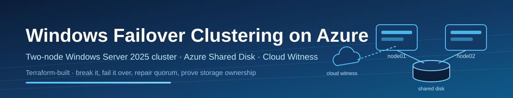
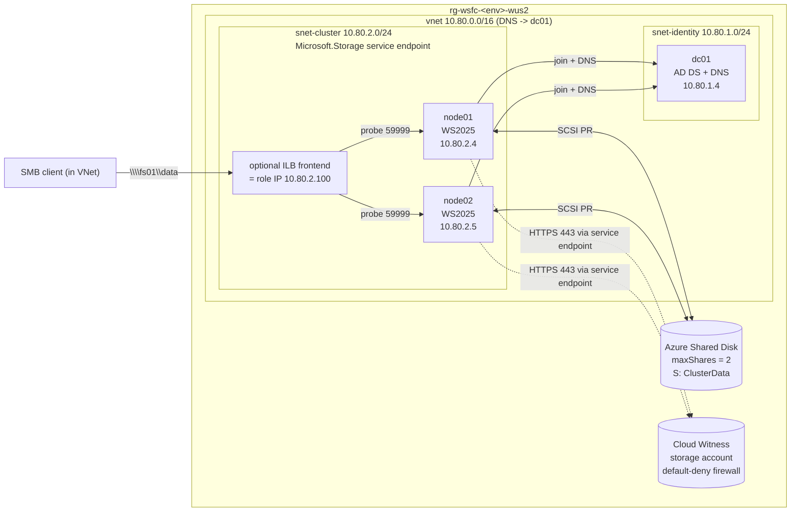

# Windows Failover Clustering on Azure

<p align="center">
  
</p>

[](https://github.com/Jamonygr/windows-failover-clustering-lab/actions/workflows/validate.yml)
[](.terraform-version)
[](LICENSE)

A cost-conscious Terraform lab that builds a **two-node Windows Server 2025
failover cluster** on Azure with an **Azure Shared Disk** (SCSI persistent
reservations) and a **Cloud Witness** quorum — then walks you through breaking
it on purpose: stop a node, prove role failover, repair a lost quorum, and
validate storage ownership.

> This is a hardened learning environment, not production guidance. Accepted
> lab-only risks live in [SECURITY_EXCEPTIONS.md](SECURITY_EXCEPTIONS.md).

One `terraform apply` produces a working, domain-joined cluster with a
clustered file server role — the drills are the only manual part.

## Architecture



Cluster management point is a **Distributed Network Name** (`wsfc01`), so the
cluster itself needs no load balancer. The clustered file server role (`fs01`)
owns the shared disk and an IP that Azure only routes to via the optional
internal Standard Load Balancer (probe-based floating IP).

## What is included

- VNet with identity/cluster subnets, NSGs, DC-pointed DNS, and a storage
  service endpoint (new VNets have **no default outbound internet**; the lab
  is designed to run fully without it).
- One WS2025 domain controller (new forest, DNS forwarder to 168.63.129.16).
- Two WS2025 cluster nodes in an availability set, domain-joined, with a
  shared managed disk (`max_shares = 2`, host caching off, Basic/GPT/NTFS).
- Fully automated WSFC build via run commands: `New-Cluster` (DNN), Cloud
  Witness quorum, clustered disk, file server role, and SMB share.
- Feature flags: internal load balancer for SMB access, Bastion Developer
  (free RDP), Log Analytics + VM availability alerts, VM auto-shutdown.
- Drill scripts that stop a node, break and force quorum, and move storage —
  each printing PASS/FAIL evidence.
- Two profiles: `cheap-lab` and `lab`. Validation-only GitHub Actions (fmt,
  validate, terraform test, TFLint, Trivy, Checkov, Gitleaks, docs drift,
  actionlint, markdownlint) with **no Azure credentials in CI**.

The generated [Terraform reference](TERRAFORM.md) is the canonical list of
root inputs and outputs; each directory under `modules/` has a generated
module reference.

## Prerequisites

- Terraform 1.15.8
- Azure CLI signed in (`az login`) and a subscription you may deploy to
- PowerShell 7 for the drill scripts
- Optional local checks: TFLint, Trivy, Checkov, Gitleaks, terraform-docs

## Secure quick start

1. Start with the cheapest profile:

   ```powershell
   Copy-Item environments/cheap-lab.tfvars terraform.tfvars
   # edit subscription_id and owner
   ```

2. Keep passwords out of files and shell history — or let Terraform generate
   them (retrieve later with `terraform output -raw admin_password`):

   ```powershell
   $env:TF_VAR_admin_password     = '<generated-password>'
   $env:TF_VAR_safe_mode_password = '<generated-password>'
   ```

3. Run local checks without touching Azure:

   ```powershell
   terraform init -backend=false
   terraform fmt -check -recursive
   terraform validate
   terraform test
   ```

4. Deploy (roughly 30-40 minutes: forest promotion, joins, feature reboots,
   and cluster formation are sequenced with settle timers):

   ```powershell
   terraform init
   terraform plan -out tfplan
   terraform apply tfplan
   terraform output next_steps
   ```

## The drills

| Drill | Script | What it proves |
|-------|--------|----------------|
| Health check | [scripts/get-cluster-health.ps1](scripts/get-cluster-health.ps1) | Nodes Up, Cloud Witness Online, role owners |
| Node failure & failover | [scripts/invoke-failover-drill.ps1](scripts/invoke-failover-drill.ps1) | Deallocates the role owner; role comes online on the survivor |
| Quorum loss & repair | [scripts/invoke-quorum-repair-drill.ps1](scripts/invoke-quorum-repair-drill.ps1) | Witness blocked + node down -> quorum lost -> `Start-ClusterNode -FixQuorum` -> full repair |
| Storage ownership | [scripts/test-storage-ownership.ps1](scripts/test-storage-ownership.ps1) | Only the owner holds the shared disk (SCSI PR); data follows a planned move |

All drills run from your workstation over `az vm run-command` — no public IPs,
no VPN, no WinRM exposure. Step-by-step explanations live in the
[wiki runbooks](wiki/runbook/01-deploy.md).

## Cost and safety

Estimates for `westus2`, rounded; verify with the Azure pricing calculator.

| Component | cheap-lab | lab |
|-----------|-----------|-----|
| 3x VM compute | ~$0.13/hr (B2s x3) | ~$0.29/hr (D2s_v5 x2 + B2ms) |
| OS disks (3x 127 GiB Standard SSD) | ~$29/mo | ~$29/mo |
| Shared data disk | ~$2.40/mo (32 GiB Standard SSD) | ~$20/mo (P10 Premium) |
| Cloud Witness storage | pennies | pennies |
| Internal load balancer | off | ~$18/mo |
| Bastion Developer / alerts / auto-shutdown | off | free / ~free |

Deallocate the VMs (or enable `enable_auto_shutdown`) when idle — compute is
the dominant cost. `terraform destroy` removes everything including the
witness account. VM-generated passwords and the witness key should be treated
as disposable lab secrets; rotate or destroy before sharing anything captured
from a run.

## Automation model

- CI is **validation-only**: pull requests and pushes run formatting,
  validation, mock-provider Terraform tests, TFLint, Trivy, Checkov,
  Gitleaks, docs drift, actionlint, and markdownlint. CI never authenticates
  to Azure, and there are no plan/apply/destroy jobs to misfire.
- Applies and destroys are always local, deliberate, and reviewed by you.
- Guest configuration is idempotent: re-running `terraform apply` against a
  configured cluster exits cleanly without re-forming anything.

## Documentation

- [Documentation home](wiki/README.md)
- [Architecture overview](wiki/architecture/overview.md)
- [Quorum and voting explained](wiki/architecture/quorum-and-voting.md)
- [Runbook: deploy](wiki/runbook/01-deploy.md)
- [Runbook: failover drill](wiki/runbook/02-failover-drill.md)
- [Runbook: quorum repair](wiki/runbook/03-quorum-repair.md)
- [Runbook: storage ownership](wiki/runbook/04-storage-ownership.md)
- [Troubleshooting](wiki/troubleshooting.md)
- [Cost guide](wiki/cost.md)
- [Contributing](CONTRIBUTING.md) · [Security policy](SECURITY.md)

## License and responsibility

MIT. Use the lab only in subscriptions where you have authorization. You
remain responsible for resources, data, access, and charges created by your
runs.
