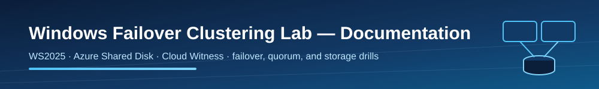

# Windows Failover Clustering Lab documentation

  

This lab is a hands-on, Terraform-first walkthrough of Windows Server
Failover Clustering (WSFC) on Azure: a two-node Windows Server 2025 cluster
backed by an Azure Shared Disk and a Cloud Witness, plus scripted drills that
break and repair it. It is written for people who want to understand how
clustering actually behaves on Azure — quorum votes, SCSI persistent
reservations, probe-based routing — without needing to be Terraform experts.
It is lab-scoped by design.

## What this lab is (and is not)

- It is a runnable reference for clustered workloads on Azure Shared Disks.
- It is optimized for learning, experimentation, and repeatable demos.
- It is not a production HA blueprint; SQL FCI, SOFS, and multi-site designs
  add requirements this lab intentionally skips.

## Who this is for

- Cloud engineers who know Azure but have never formed a cluster in it.
- Windows admins who know WSFC but not how Azure changes the rules
  (no gratuitous ARP, probe-routed cluster IPs, cloud quorum).
- Anyone preparing failover, quorum, or storage-ownership interview demos.

## What you will deploy

| Component | Purpose |
|-----------|---------|
| `dc01` (B2s) | AD DS forest `wsfclab.local`, VNet DNS, forwarder to Azure DNS |
| `node01`, `node02` | WS2025 cluster nodes in an availability set |
| Azure Shared Disk | `max_shares = 2` data disk; the clustered `S:` volume |
| Cloud Witness storage | Quorum blob account behind a default-deny firewall |
| `wsfc01` | The cluster, with a Distributed Network Name management point |
| `fs01` | Clustered file server role owning the disk and an IP |
| Optional | Internal LB (SMB routing), Bastion Developer, monitoring, auto-shutdown |

## Article map

| Topic | What you will learn |
|-------|---------------------|
| [Architecture overview](architecture/overview.md) | How the root module orchestrates network, DC, witness, and cluster — and why the ordering matters. |
| [Quorum and voting](architecture/quorum-and-voting.md) | Votes, dynamic quorum, dynamic witness, and why the drill blocks the witness before killing the node. |
| [Runbook: deploy](runbook/01-deploy.md) | Applying a profile and verifying the cluster came up. |
| [Runbook: failover drill](runbook/02-failover-drill.md) | Stop the role owner, watch the role move. |
| [Runbook: quorum repair](runbook/03-quorum-repair.md) | Lose quorum for real, force it back, restore all votes. |
| [Runbook: storage ownership](runbook/04-storage-ownership.md) | Prove SCSI PR ownership follows the role. |
| [Variables reference](reference/variables.md) | The inputs you set in `terraform.tfvars`. |
| [Naming conventions](reference/naming.md) | CAF-style names used throughout. |
| [Troubleshooting](../wiki/troubleshooting.md) | Logs, common failures, and recovery paths. |
| [Cost guide](../wiki/cost.md) | What the lab costs and how to keep it near zero. |

## Before you start

- Azure subscription with rights to create VMs, disks, storage, and networks.
- Terraform 1.15.8, Azure CLI, PowerShell 7.
- Budget awareness: three VMs are the dominant cost. Start with `cheap-lab`
  and destroy or deallocate when finished.
- Time awareness: the full apply takes 30-40 minutes because AD promotion,
  domain joins, feature reboots, and cluster formation are sequenced.

## Quick path

1. Copy `environments/cheap-lab.tfvars` to `terraform.tfvars` and set
   `subscription_id`.
2. Provide secrets via ephemeral `TF_VAR_*` variables, or let Terraform
   generate them.
3. `terraform init && terraform plan -out tfplan && terraform apply tfplan`.
4. Run `./scripts/get-cluster-health.ps1`, then work through the runbooks.
5. `terraform destroy` when done.

## Helpful Microsoft resources

- Azure Shared Disks: <https://learn.microsoft.com/azure/virtual-machines/disks-shared>
- Enable shared disks: <https://learn.microsoft.com/azure/virtual-machines/disks-shared-enable>
- Cloud Witness: <https://learn.microsoft.com/windows-server/failover-clustering/deploy-cloud-witness>
- Failover clustering: <https://learn.microsoft.com/windows-server/failover-clustering/failover-clustering-overview>
