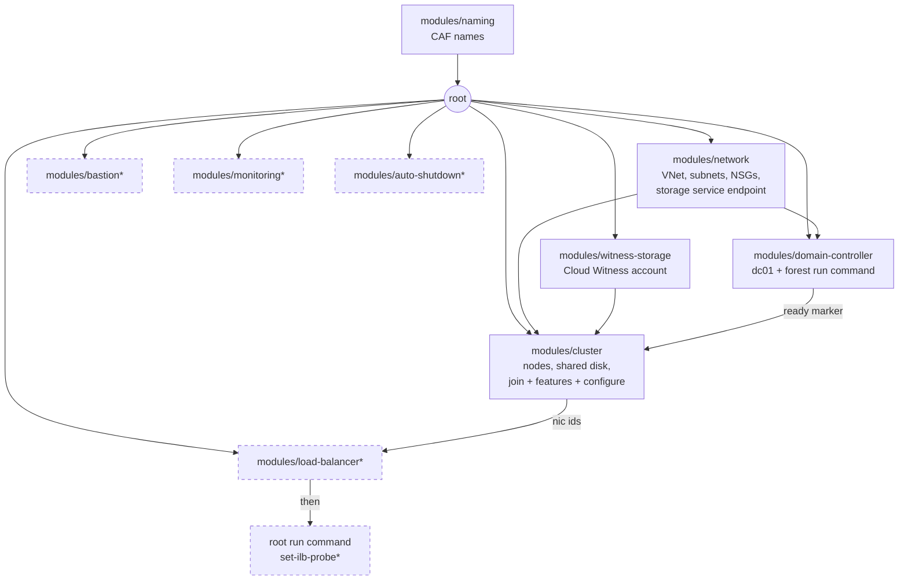

# Architecture overview

This article explains how the root Terraform module builds the lab, in what
order, and why the sequencing exists. By the end you will know which module
owns what and where the moving parts of the cluster build live.

## The five root files

| File | Role |
|------|------|
| [main.tf](../../main.tf) | Orchestration: naming -> network -> witness -> DC -> cluster -> optional extras |
| [variables.tf](../../variables.tf) | All inputs with validation (profiles set these) |
| [locals.tf](../../locals.tf) | Tags, generated-secret fallbacks, guest script contents |
| [outputs.tf](../../outputs.tf) | Connection map, drill commands, sensitive password output |
| [backend.tf](../../backend.tf) | Local state by default; azurerm backend commented |

## Module map

`*` = feature-flagged, default off.

## Execution order at a glance

1. **Network**: VNet DNS points at the (future) DC IP; the cluster subnet
   gets a `Microsoft.Storage` service endpoint. New VNets have no default
   outbound internet, so every later step is designed around the Azure agent
   channel and that endpoint.
2. **Witness storage**: default-deny firewall; only the cluster subnet (and
   optional admin IPs) can reach the blob endpoint.
3. **Domain controller**: VM builds, then a run command installs AD DS and
   promotes the forest with `-NoRebootOnCompletion`, schedules
   `shutdown /r /t 30`, and exits 0 — a reboot inside a run command would
   fail it. A `time_sleep` (default 6m) covers reboot plus AD warm-up and
   becomes the **DC-ready marker**.
4. **Cluster nodes** build in parallel with the DC (they only gate on the
   marker at the join step):
   - `JsonADDomainExtension` joins each node (the extension handles its own
     reboot),
   - a run command installs Failover Clustering + File Server and schedules
     a deterministic reboot,
   - the shared disk attaches to both nodes with `caching = None` (required
     for shared disks),
   - one run command on node01 forms everything (next section).
5. **Optional extras**: ILB (frontend = role IP), probe run command, Bastion
   Developer, monitoring, auto-shutdown.

## How the cluster-configure step works

Run commands execute as SYSTEM. SYSTEM cannot create the cluster's Active
Directory objects (CNO/VCO), so
[scripts/vm/configure-cluster.ps1](../../scripts/vm/configure-cluster.ps1)
relays the work to a **scheduled task running as the domain admin** (password
logon = a full network token, no double-hop). The task:

1. waits for node02 on port 445,
2. `New-Cluster -ManagementPointNetworkType Distributed -NoStorage` — the
   DNN management point resolves to node IPs, so the cluster name needs no
   load balancer,
3. `Set-ClusterQuorum -CloudWitness` (3 attempts),
4. onlines/initializes/formats the shared disk (GPT, NTFS, `S:`) and adds it
   as cluster disk `fs-data-disk`,
5. creates the `fs01` file server role with a static IP and a clustered SMB
   share,
6. writes a JSON result the wrapper polls, then cleans up the task and the
   ACL-restricted config file.

Every step is idempotent — re-running `terraform apply` against a healthy
cluster exits early without touching it.

## Why the role IP needs a load balancer (but the cluster name does not)

Azure ignores gratuitous ARP, so an IP that fails over inside guests is
invisible to the fabric. Two patterns fix this:

- **Distributed Network Name** (used for `wsfc01`): the name resolves to the
  node IPs directly; no extra infrastructure.
- **Probe-routed IP** (used for `fs01`): the internal Standard LB owns the
  role IP as a frontend; the cluster IP resource answers the probe port only
  on the owning node, so Azure routes SMB to the right place. Without the
  `deploy_load_balancer` flag the role still runs — the drills validate it
  via cluster state — but SMB clients cannot reach the share.

## Related pages

- [Quorum and voting](quorum-and-voting.md)
- [Runbook: deploy](../runbook/01-deploy.md)
- [Naming conventions](../reference/naming.md)
- [Variables reference](../reference/variables.md)
